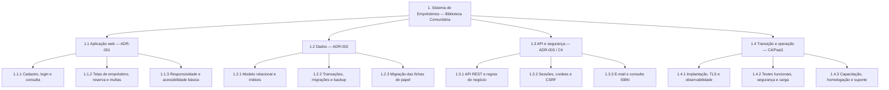
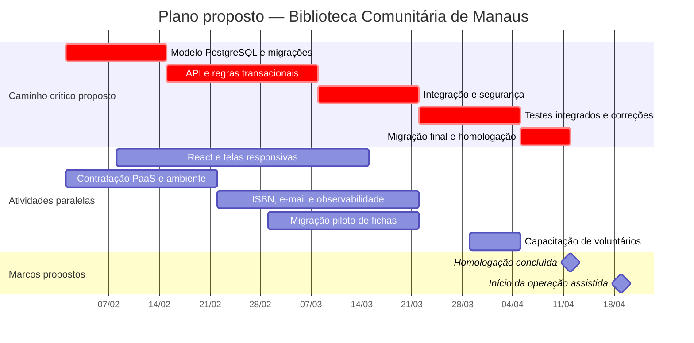

# Etapa 2 — Plano de Projeto

**Acadêmica:** Luccie Bonates Simões  
**Instituição:** Centro Universitário de Ensino Superior do Amazonas (CIESA)  
**Disciplina:** Projetos de Sistemas  
**Projeto:** Sistema de Empréstimos da Biblioteca Comunitária de Manaus  
**Base:** [Etapa 1 — requisitos, arquitetura C4 e ADRs](https://github.com/ArrayOfLoot/biblioteca-comunitaria)

> **Natureza das estimativas:** planejamento acadêmico prospectivo. Datas, preços, salários e prazos abaixo são premissas de simulação, não propostas comerciais, contratações realizadas ou dados medidos. O projeto da Etapa 1 descreve arquitetura, não um sistema já implementado.

## 1. Fundamentação arquitetural e tabela de impacto

A Etapa 1 definiu cliente React SPA responsivo, API REST Node.js/Express, PostgreSQL gerenciado em PaaS, comunicação HTTPS, autenticação por sessão no servidor e integrações de e-mail e consulta ISBN. Os três ADRs aceitos são: **ADR-001** (web responsiva em vez de app nativo), **ADR-002** (PostgreSQL em vez de NoSQL) e **ADR-003** (sessões no servidor em vez de JWT). Os componentes C4 incluem acervo, leitores, empréstimos e multas, reservas e notificações.

| Decisão da Etapa 1 | Escopo criado / eliminado | Cronograma e dependência | Custo em três anos | Risco e resposta | Construir × comprar | Competência / operação |
|---|---|---|---|---|---|---|
| ADR-001 — React SPA responsiva | Criar telas responsivas, testes de navegadores e treinamento; eliminar aplicativos Android/iOS nativos | Contrato da API antes da integração; testes de 360 px após telas | Desenvolvimento único e hospedagem web; alternativa nativa comparada na seção 4 | Incompatibilidade móvel: teste em dispositivos e navegadores | Construir SPA; contratar hospedagem estática/PaaS | Front-end implementa; suporte orienta voluntários |
| ADR-002 — PostgreSQL relacional | Criar esquema, índices, migração das fichas e backup; eliminar implantação MongoDB | Modelo e migrações antes das transações e testes integrados | Banco gerenciado, backups e manutenção | Empréstimo duplicado: transação, restrições e teste concorrente | Construir esquema; contratar banco gerenciado | Back-end/DBA; responsável técnico opera backups |
| ADR-003 — sessão no servidor | Criar tabela de sessões, cookies seguros, CSRF e bloqueio de login; eliminar infraestrutura JWT e lista de revogação | Modelo de usuários antes de login; autenticação antes da homologação | Desenvolvimento e armazenamento de sessões | Sequestro de sessão: HttpOnly, Secure, SameSite, CSRF e TLS | Construir autenticação; usar infraestrutura PaaS | Back-end/segurança; suporte revoga acessos |
| C4 — API Node/Express, PaaS e serviços externos | Criar endpoints, integrações ISBN/e-mail, telemetria e capacitação | API antes de integrações; observabilidade antes de teste de carga | Hospedagem, envio de e-mail, domínio e monitoramento | Falha do provedor: timeout, retentativa controlada e fallback manual | Construir API; contratar serviços externos | Back-end, DevOps e bibliotecário operador |

## 2. Escopo — EAP com três níveis

**Entregável final:** sistema web operacional, dados iniciais migrados, voluntários capacitados e operação acompanhada. **Fora do escopo:** aplicativo nativo, uso offline, push nativo, integração com pagamentos eletrônicos e escalabilidade multi-instância; são exclusões coerentes com os ADRs e C4 originais.

| Pacote principal | Entrega verificável | Origem | Responsável | Depende de | Habilita |
|---|---|---|---|---|---|
| 1.1 Aplicação web | SPA responsiva com fluxos RF01–RF12 pertinentes aos perfis | ADR-001; RNF05–06 | Front-end | Contrato API e autenticação para integração | Homologação dos usuários |
| 1.2 Dados | PostgreSQL, índices, transações, migração e backup testado | ADR-002; RN01–06 | Back-end/DBA | Modelo de domínio validado | API transacional |
| 1.3 API e segurança | REST, sessão revogável, CSRF, ISBN e e-mail | ADR-003; C4 níveis 2–3 | Back-end | Esquema de dados | Integração e testes |
| 1.4 Transição e operação | Ambiente PaaS, métricas, testes, fichas migradas e treinamento | C4; RNF01–04; operação por voluntários | DevOps/QA/bibliotecário | Aplicação integrada | Entrada em produção |

**Pacote eliminado:** desenvolvimento e publicação de aplicativos móveis nativos (ADR-001). Também se eliminam a configuração de MongoDB (ADR-002) e a implementação de JWT com lista de revogação (ADR-003).

## 3. Cronograma, dependências e caminho crítico

**Premissa:** dias de trabalho estimados, com início hipotético em 2027-02-01. O cronograma Gantt usa dias corridos para facilitar a leitura; durações de pacotes PERT na seção 5 são dias úteis de esforço e não devem ser somadas diretamente ao calendário sem considerar paralelismo e capacidade da equipe. Datas de homologação e lançamento são **marcos propostos**, sujeitos à confirmação com a biblioteca e o professor.

| Precedência | Justificativa arquitetural |
|---|---|
| Modelo PostgreSQL → API de empréstimos | As transações de exemplar, leitor e multa exigem tabelas e restrições definidas (ADR-002). |
| Sessões e autorização → testes integrados de perfis | Os três perfis exigem autorização e bloqueio imediato (ADR-003). |
| Contrato REST → integração React | A SPA consome endpoints HTTPS/JSON definidos no C4. |
| API → integrações ISBN/e-mail | Os adaptadores externos pertencem à camada de dados/integrações do servidor. |
| Instrumentação → teste de carga | Sem métricas não se verifica RNF01 (95% das consultas até 2 s com 50 usuários). |
| Migração piloto → homologação | Fichas de papel precisam ser conferidas antes de liberar empréstimos reais. |
| Capacitação → operação assistida | Voluntários precisam registrar empréstimos e devoluções corretamente. |

**Caminho crítico preliminar:** modelo PostgreSQL → API transacional → integração/segurança → testes integrados → migração final/homologação. A sequência deve ser recalculada no acompanhamento se as atividades paralelas (sobretudo React e contratação) consumirem a folga. **Marcos imóveis para a linha de base proposta:** homologação até 12/04/2027 e início da operação assistida em 19/04/2027, **apenas após aprovação formal**; não são datas impostas pela Etapa 1. Se a contratação pública for necessária, o marco deve ser replanejado para acomodar o prazo de aquisição.

## 4. Custo total de propriedade — três anos

**Premissas financeiras didáticas:** valores em reais constantes, sem inflação; implantação inclui trabalho contratado/valorado e configuração inicial; operação anual inclui PaaS, banco, domínio, e-mail, monitoramento, suporte e manutenção. O trabalho voluntário não é considerado gratuito na estimativa de esforço de implantação. A comparação usa a mesma cobertura funcional dos RFs, com alternativas arquiteturais diferentes.

| Alternativa | Implantação | Operação/ano | Operação 3 anos | Total 3 anos |
|---|---:|---:|---:|---:|
| **A — arquitetura escolhida:** React SPA + Node/Express + PostgreSQL gerenciado + sessões | R$ 36.000 | R$ 9.600 | R$ 28.800 | **R$ 64.800** |
| B — app Android/iOS nativo + API + PostgreSQL gerenciado | R$ 68.000 | R$ 16.800 | R$ 50.400 | **R$ 118.400** |

**Composição estimada da alternativa A (implantação):** web responsiva R$ 9.000; API e regras R$ 10.000; banco/migração R$ 5.000; segurança e testes R$ 5.000; implantação/observabilidade R$ 4.000; capacitação R$ 3.000 = **R$ 36.000**. **Operação anual:** PaaS + banco/backup R$ 4.800; e-mail, domínio e monitoramento R$ 1.200; manutenção corretiva e suporte R$ 3.600 = **R$ 9.600**. São verbas de planejamento, não cotações de fornecedores.

**Composição estimada da alternativa B:** implementação de dois clientes móveis, testes e publicação elevam a implantação para R$ 68.000; atualizações das duas plataformas, distribuição e suporte elevam a operação a R$ 16.800/ano. A alternativa A economiza **R$ 53.600** em três anos (aproximadamente 45,3% do custo da B), além de atender o computador do balcão. A escolha é coerente com o ADR-001.

**Limites de orçamento:** o enunciado apresenta R$ 1,2 milhão de investimento e R$ 300 mil/ano de custeio no **exemplo UNIVA**, não como teto confirmado para esta biblioteca. Portanto, não se assume que esses limites pertençam ao projeto comunitário; os valores reais dependem de validação com seu responsável.

## 5. Estimativas de três pontos — PERT

**Fórmulas:** PERT = (O + 4M + P)/6; desvio aproximado = (P − O)/6. Unidade: **dias úteis de esforço por pacote**. As caudas pessimistas incorporam riscos da arquitetura e da transição.

| Pacote | O | M | P | PERT (dias) | Desvio (dias) | Justificativa para P |
|---|---:|---:|---:|---:|---:|---|
| 1.1 React SPA | 15 | 22 | 34 | 22,8 | 3,2 | Ajustes em navegadores e telas de 360 px (ADR-001). |
| 1.2 PostgreSQL e migração | 10 | 16 | 30 | 17,3 | 3,3 | Fichas inconsistentes, índices e transações (ADR-002). |
| 1.3 API, sessões e integrações | 18 | 26 | 42 | 27,3 | 4,0 | CSRF, concorrência, falhas de ISBN/e-mail (ADR-003/C4). |
| 1.4 Implantação, testes e capacitação | 12 | 19 | 33 | 20,2 | 3,5 | Provedor, carga de 50 usuários e treinamento de voluntários. |
| **Soma de esforços** | **55** | **83** | **139** | **87,7** | — | **Não é duração do cronograma**, pois há atividades paralelas. |

Exemplo de cálculo para 1.3: (18 + 4×26 + 42)/6 = **27,3 dias**; (42 − 18)/6 = **4,0 dias**. A soma de desvios não representa desvio total do projeto; para calcular incerteza do caminho crítico, é necessário modelar as atividades críticas e suas dependências em granularidade compatível.

## 6. Registro de riscos e reservas

| ID | Risco e origem | Probabilidade/impacto | Resposta planejada | Gatilho objetivo | Reserva |
|---|---|---|---|---|---|
| R1 | Dois empréstimos simultâneos do mesmo exemplar (**arquitetural**, ADR-002) | Média/Alta | Mitigar: transações, restrição de unicidade apropriada e teste concorrente | Qualquer duplicidade em teste de 50 usuários | Contingência |
| R2 | Falha de sessão, CSRF ou bloqueio de conta (**arquitetural**, ADR-003) | Média/Alta | Mitigar: cookies Secure/HttpOnly/SameSite, token CSRF, testes de revogação | Teste comprova sessão ativa após desativação ou 5 falhas sem bloqueio | Contingência |
| R3 | ISBN ou e-mail externo indisponível (**arquitetural**, C4) | Alta/Média | Mitigar: timeout, fila/reenvio para e-mail e cadastro manual de livro | 3 falhas consecutivas em 15 minutos | Contingência |
| R4 | Pesquisa supera 2 segundos em 5% ou mais das consultas (**arquitetural**, ADR-002/RNF01) | Média/Alta | Mitigar: índices, EXPLAIN ANALYZE e teste de carga | Percentil 95 acima de 2 s com 50 usuários | Contingência |
| R5 | Dados de fichas de papel incompletos (**projeto**, migração) | Alta/Média | Mitigar: inventário, limpeza, migração piloto e dupla conferência | Mais de 5% dos registros com inconsistência na amostra | Contingência |
| R6 | Voluntários não dominam o fluxo (**equipe**, transição) | Média/Média | Mitigar: capacitação, manual e operação assistida | Menos de 80% de acertos na simulação de atendimento | Contingência |
| R7 | Contratação/ativação do PaaS atrasa (**projeto**, C4) | Média/Alta | Mitigar: contratar cedo e prever ambiente alternativo homologado | Provedor não ativado 15 dias antes dos testes integrados | Contingência |
| R8 | Incidente imprevisto não identificado no planejamento (**projeto**) | Indeterminada/Alta | Escalar à direção e deliberar uso de reserva gerencial | Evento novo sem cobertura no registro de riscos | Gerencial |

**Reserva de contingência:** R$ 5.400 (15% da implantação A), incluída na **linha de base de implantação de R$ 41.400**, para respostas a R1–R7. **Reserva gerencial:** R$ 3.600 (10% da implantação-base), fora da linha de base e liberada apenas pelo patrocinador para imprevistos. **Orçamento autorizado potencial:** R$ 45.000 de implantação (R$ 36.000 + R$ 5.400 + R$ 3.600). Com três anos de operação previstos (R$ 28.800), o desembolso potencial total é **R$ 73.800**. O TCO comparativo da seção 4 exclui reservas para comparar as alternativas na mesma base; elas são apresentadas separadamente para não haver dupla contagem.

## 7. Aquisições — construir × comprar e saída de fornecedor

| Item | Decisão | Prazo planejado | Dependência e estratégia de saída |
|---|---|---|---|
| React SPA e API Node/Express | Construir | Conforme cronograma | Código próprio em Git, documentação e contratos REST; evita dependência de software proprietário. |
| PostgreSQL e esquema | Construir esquema; contratar hospedagem gerenciada | 15–30 dias, **se contratação privada simplificada** | Exportação SQL/backup e restauração em outro PostgreSQL; estimativa de migração 5–10 dias úteis e R$ 2.000–4.000. |
| PaaS, TLS e monitoramento | Comprar serviço | 15–30 dias, **se contratação privada simplificada** | Configuração reproduzível, variáveis de ambiente e testes de restauração; saída 5–10 dias úteis, R$ 2.000–4.000. |
| E-mail transacional e ISBN | Usar serviços externos | 5–15 dias para cadastro/testes | Adaptadores isolados; trocar provedor requer 2–5 dias úteis e R$ 800–2.000 por integração, além de revalidar contratos e limites. |
| Treinamento e operação assistida | Desenvolver internamente / contratar apoio pontual | 5–10 dias úteis | Material e manuais permanecem com a biblioteca. |

**Lei 14.133/2021:** se a biblioteca contratar como órgão ou entidade sujeita à lei, adota-se **premissa conservadora de pelo menos 90 dias** para o processo de aquisição, conforme orientação didática do enunciado, e o cronograma de implantação deverá ser antecipado ou replanejado. Esse prazo não é mínimo legal universal aplicável a toda contratação: depende da modalidade e do caso. Se a biblioteca comunitária for uma entidade privada sem contratação pública, a lei não se aplica automaticamente e prevalecem os prazos simplificados acima. A natureza jurídica e a fonte de recursos devem ser confirmadas antes da linha de base definitiva.

**Estimativa de lock-in:** migração de PaaS e banco em conjunto: aproximadamente **10–20 dias úteis** e **R$ 4.000–8.000**, com reconfiguração de deploy, segredos, DNS, backups, conexões e testes; troca de serviços externos acrescenta tempo/custo conforme a tabela. Esses valores são hipóteses de planejamento, não preços de mercado comprovados.

## 8. Recursos humanos, operação e comunicação

| Papel (alocação proposta) | Pacotes | Responsabilidade após entrega |
|---|---|---|
| Analista/gerente do projeto (parcial) | Todos; requisitos e aceite | Acompanhar indicadores, orçamento e mudanças |
| Desenvolvedor front-end | 1.1 | Manutenção da SPA e compatibilidade dos navegadores |
| Desenvolvedor back-end/DBA | 1.2 e 1.3 | Integridade, backups, restauração, API e sessões |
| DevOps/QA (parcial) | 1.4 e apoio a 1.1–1.3 | Monitoramento, certificados, testes e incidentes |
| Bibliotecário responsável (representante operacional) | 1.2.3 e 1.4.3 | Conferir acervo, autorizar empréstimos, treinar voluntários |
| Voluntários do balcão | Homologação e 1.4.3 | Cadastro, empréstimo, devolução e atendimento diário |

**Competências a desenvolver:** 5 dias úteis de capacitação técnica em backup/restauração PostgreSQL, segurança de sessões e observabilidade para o responsável técnico, mais 5 dias úteis de capacitação funcional dos voluntários (sessões de treinamento e simulação). O custo de **R$ 3.000** de capacitação já está na implantação A; não é custo adicional. A capacitação funcional deve anteceder a operação assistida; a técnica deve anteceder a homologação da infraestrutura.

**Lei de Brooks:** adicionar pessoas no meio do atraso aumenta coordenação e integração; a resposta prioritária será reduzir escopo não crítico, remover impedimentos e replanejar, em vez de simplesmente contratar mais desenvolvedores. **Lei de Conway:** a divisão em front-end, API/dados e operação precisa ser compensada por contrato OpenAPI, revisões cruzadas e reuniões curtas, evitando interfaces inconsistentes entre equipes.

**Operação proposta:** bibliotecário responsável responde pelo processo e qualidade cadastral; técnico de suporte responde por infraestrutura, certificados, backups e restauração; administrador gerencia contas dos bibliotecários conforme RF12. Não se pressupõe que uma pessoa específica já aceitou esses papéis.

## 9. Critérios de aceite e rastreabilidade

| Critério | Origem | Evidência planejada |
|---|---|---|
| Pesquisa até 2 s em 95% das requisições com 50 usuários simultâneos | RNF01 / ADR-002 | Relatório de teste de carga com percentil 95 |
| 100% do tráfego cliente-servidor em HTTPS/TLS 1.2+ | RNF02 / C4 | Verificação TLS e redirecionamento HTTP |
| Bloqueio por 15 minutos após 5 senhas erradas | RNF03 / ADR-003 | Teste automatizado de autenticação |
| Disponibilidade mensal mínima de 99% no horário 8h–20h | RNF04 / PaaS | Monitoramento mensal e relatório de incidentes |
| Cadastro em até 3 minutos sem auxílio | RNF05 / ADR-001 | Teste de usabilidade com leitores |
| Compatibilidade com navegadores indicados e telas de 360 px | RNF06 / ADR-001 | Matriz de testes de navegadores e responsividade |
| Prazo 14 dias, multa R$ 0,50/dia, limite de 3 itens, bloqueios e renovação | RN01–RN05 / ADR-002 | Testes de regras de negócio e concorrência |
| Aviso por e-mail 2 dias antes do vencimento | RF10 / C4 | Teste de agendamento e integração de e-mail |
| Fichas migradas e equipe capacitada | EAP de transição | Ata de conferência, treinamento e aceite do bibliotecário |

## 10. Premissas, restrições e conclusão

**Premissas:** biblioteca comunitária de pequeno porte; até 50 usuários simultâneos (RNF01); conexão com a internet disponível; operação em uma instância de servidor (ADR-003); dados iniciais em fichas de papel; preços, equipe e datas estimados apenas para o exercício. **Restrições:** não implementar offline nem aplicativos nativos (ADR-001); manter consistência transacional (ADR-002); usar sessões revogáveis (ADR-003); proteger dados pessoais; preservar os requisitos e regras da Etapa 1.

A arquitetura escolhida permite um projeto menor e coerente com a realidade da biblioteca: a SPA evita duplicação de aplicativos, PostgreSQL protege a consistência do acervo e das operações, e sessões no servidor facilitam o bloqueio imediato de contas. O plano explicita o trabalho de transição que a arquitetura exige — migração, observabilidade, testes, treinamento e operação —, compara custos de três anos e associa riscos a gatilhos objetivos. Antes da execução real, devem ser validados orçamento, equipe, calendário, regime de contratação e capacidade dos fornecedores.

## Referências

- BONATES SIMÕES, Luccie. *Biblioteca Comunitária: requisitos e arquitetura de um sistema*. Etapa 1, CIESA, 2026. https://github.com/ArrayOfLoot/biblioteca-comunitaria
- CIESA. *Etapa 2 — Do projeto ao plano de projeto*. Enunciado da disciplina Projetos de Sistemas, 2026.
- PROJECT MANAGEMENT INSTITUTE. *Guia PMBOK*, 7ª ed.
- BROOKS, Frederick P. *The Mythical Man-Month*.
- BRASIL. Lei nº 14.133, de 1º de abril de 2021.
