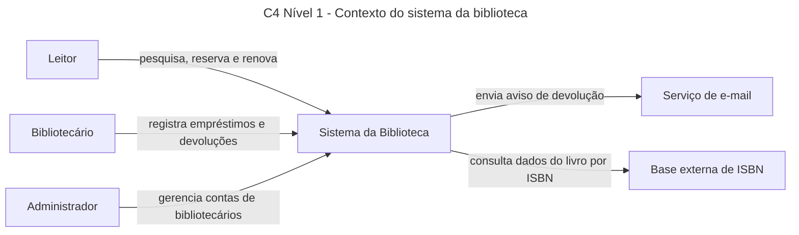
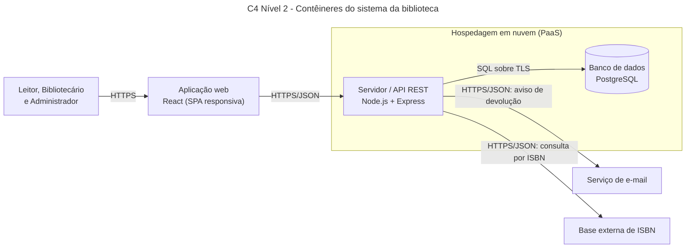
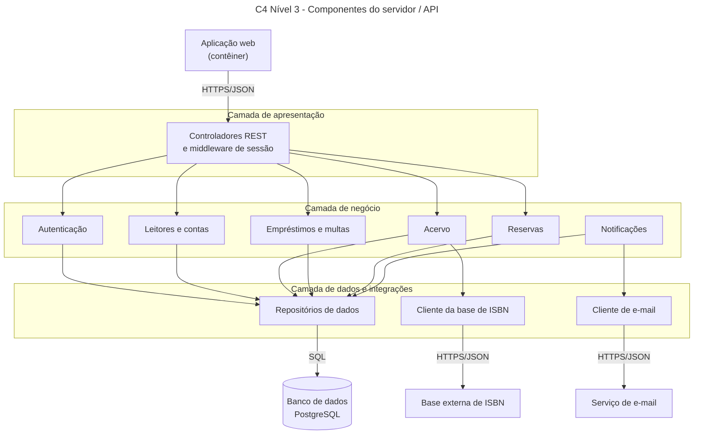
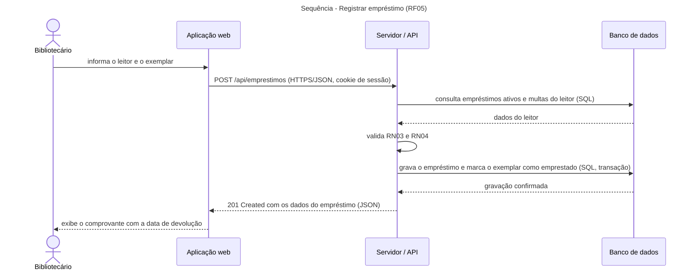

# Biblioteca Comunitária: Requisitos e Arquitetura de um Sistema

**Disciplina:** Projetos de Sistemas · CIESA (Centro Universitário de Ensino Superior do Amazonas)
**Trabalho:** individual
**Autora:** Luchie Bonates Simões
**Tema:** sistema de empréstimos para uma biblioteca comunitária de Manaus

<!-- Os comentários como este não aparecem no GitHub. Servem de lembrete e podem ser apagados no final. -->

---

## Sumário

- [Parte 1: Requisitos](#parte-1-requisitos)
  - [1.1 Descrição do sistema](#11-descrição-do-sistema)
  - [1.2 Tabela de requisitos](#12-tabela-de-requisitos)
- [Parte 2: Documento de arquitetura](#parte-2-documento-de-arquitetura)
  - [2.1 Diagramas C4](#21-diagramas-c4-níveis-1-a-3)
  - [2.2 Registros de decisão (ADRs)](#22-registros-de-decisão-adrs)
  - [2.3 Comunicação cliente-servidor](#23-comunicação-cliente-servidor)
  - [2.4 Rastreabilidade](#24-rastreabilidade)

---

## Parte 1: Requisitos

### 1.1 Descrição do sistema

<!-- Um parágrafo sobre o negócio e os tipos de usuário: leitor, bibliotecário e administrador. -->

A Biblioteca Comunitária de Manaus é uma biblioteca de bairro mantida por doações e trabalho voluntário, que empresta livros gratuitamente a moradores associados. Hoje o controle é feito em fichas de papel, o que causa perda de prazos, livros emprestados em duplicidade e dificuldade de saber o que existe no acervo. O sistema proposto organiza o acervo, os empréstimos, as devoluções e as multas. Há três tipos de usuário: o **leitor**, que se cadastra, pesquisa livros, reserva, renova e acompanha seus empréstimos; o **bibliotecário**, que cadastra livros e registra empréstimos, devoluções e pagamentos de multa no balcão; e o **administrador**, que gerencia as contas dos bibliotecários. O sistema conversa com dois sistemas externos: um **serviço de e-mail**, usado nos avisos de devolução, e uma **base externa de consulta por ISBN**, usada para preencher os dados dos livros cadastrados.

### 1.2 Tabela de requisitos

<!-- Mínimos: 10 RF, 6 RNF (mensuráveis, em pelo menos 4 categorias) e 5 RN. -->
<!-- RF: "O sistema deve permitir que [usuário] [ação]". RNF: sempre com medida. RN: vale mesmo sem o sistema. -->

#### Requisitos funcionais (RF)

| Código | Tipo | Descrição | Prioridade |
|---|---|---|---|
| RF01 | Funcional | O sistema deve permitir que o leitor se cadastre informando nome, documento, e-mail e telefone. | Alta |
| RF02 | Funcional | O sistema deve permitir que o leitor, o bibliotecário e o administrador entrem no sistema com e-mail e senha. | Alta |
| RF03 | Funcional | O sistema deve permitir que o leitor pesquise livros por título, autor, ISBN ou categoria e veja a disponibilidade dos exemplares. | Alta |
| RF04 | Funcional | O sistema deve permitir que o bibliotecário cadastre um livro a partir do ISBN, com os dados preenchidos por consulta a uma base externa. | Alta |
| RF05 | Funcional | O sistema deve permitir que o bibliotecário registre o empréstimo de um exemplar a um leitor. | Alta |
| RF06 | Funcional | O sistema deve permitir que o bibliotecário registre a devolução de um exemplar. | Alta |
| RF07 | Funcional | O sistema deve permitir que o leitor renove um empréstimo ativo. | Média |
| RF08 | Funcional | O sistema deve permitir que o leitor reserve um livro que está emprestado. | Média |
| RF09 | Funcional | O sistema deve permitir que o leitor consulte seus empréstimos, prazos de devolução e multas. | Média |
| RF10 | Funcional | O sistema deve permitir que o leitor receba por e-mail um aviso 2 dias antes do vencimento do empréstimo. | Média |
| RF11 | Funcional | O sistema deve permitir que o bibliotecário registre o pagamento de uma multa. | Média |
| RF12 | Funcional | O sistema deve permitir que o administrador gerencie as contas dos bibliotecários. | Média |

#### Requisitos não funcionais (RNF)

| Código | Tipo | Descrição | Prioridade |
|---|---|---|---|
| RNF01 | Desempenho | A pesquisa no acervo deve retornar resultados em até 2 segundos em 95% das requisições, com até 50 usuários simultâneos. | Alta |
| RNF02 | Segurança | Toda comunicação entre o cliente e o servidor deve usar HTTPS com TLS 1.2 ou superior em 100% das requisições. | Alta |
| RNF03 | Segurança | A conta de um usuário deve ser bloqueada por 15 minutos após 5 tentativas de login consecutivas com senha errada. | Média |
| RNF04 | Disponibilidade | O sistema deve ter disponibilidade mínima de 99% por mês no horário de funcionamento da biblioteca (8h às 20h). | Alta |
| RNF05 | Usabilidade | Um leitor novo deve conseguir concluir o cadastro em até 3 minutos, sem ajuda de outra pessoa. | Média |
| RNF06 | Compatibilidade | O sistema deve funcionar nas duas últimas versões do Chrome, Firefox, Edge e Safari, em telas a partir de 360 pixels de largura. | Alta |

#### Regras de negócio (RN)

| Código | Tipo | Descrição | Prioridade |
|---|---|---|---|
| RN01 | Regra de negócio | O prazo de empréstimo é de 14 dias corridos. | Alta |
| RN02 | Regra de negócio | O atraso na devolução gera multa de R$ 0,50 por dia, por item. | Alta |
| RN03 | Regra de negócio | Cada leitor pode ter no máximo 3 itens emprestados ao mesmo tempo. | Alta |
| RN04 | Regra de negócio | Leitor com multa pendente ou com item em atraso não pode retirar novos itens. | Média |
| RN05 | Regra de negócio | Cada empréstimo pode ser renovado uma única vez, por mais 7 dias, e somente se não houver reserva para o livro. | Média |
| RN06 | Regra de negócio | Menores de 18 anos só podem se associar com autorização de um responsável. | Média |

---

## Parte 2: Documento de arquitetura

A arquitetura é cliente-servidor: uma aplicação web (cliente) conversa por HTTPS com um servidor/API, que guarda os dados em um banco relacional e se integra a dois serviços externos.

### 2.1 Diagramas C4 (níveis 1 a 3)

#### Nível 1: Contexto



**Legenda:** as caixas são pessoas (Leitor, Bibliotecário, Administrador), o sistema da biblioteca e os sistemas externos (e-mail e ISBN). Cada seta indica o que trafega entre eles.

#### Nível 2: Contêineres



**Legenda:** cada contêiner mostra a tecnologia escolhida. Cada seta mostra o protocolo e, quando útil, o que trafega. O servidor e o banco rodam em uma hospedagem em nuvem gerenciada (atende o RNF04), e todo o tráfego do cliente usa HTTPS (atende o RNF02).

#### Nível 3: Componentes do servidor



**Legenda:** os módulos do servidor estão agrupados nas três camadas: apresentação (recebe as requisições), negócio (aplica as regras RN01 a RN06) e dados (acesso ao banco e às integrações). As caixas fora das camadas são vizinhos do servidor.


---

### 2.2 Registros de decisão (ADRs)

#### ADR-001: Adotar um cliente web responsivo em vez de um aplicativo móvel

**Status:** aceita
**Data:** 2026-11-04

**Contexto**
O RNF06 exige que o sistema funcione nos principais navegadores e em telas a partir de 360 pixels, e o RNF05 exige que um leitor novo conclua o cadastro em até 3 minutos, sem ajuda. A biblioteca é comunitária, atendida por voluntários, e os leitores usam celulares variados, enquanto o bibliotecário usa um computador no balcão.

**Alternativas consideradas**
- **Alternativa A: aplicativo móvel nativo (Android).** A favor: acesso a recursos do aparelho, notificações push e uso offline parcial. Contra: exige instalação por loja de aplicativos, precisa de versões separadas para Android e iOS, tem custo de publicação e manutenção, e não atende o computador do balcão.
- **Alternativa B: aplicação web responsiva (SPA).** A favor: não exige instalação, usa uma única base de código para celular e computador, atualiza para todos ao mesmo tempo. Contra: depende de conexão com a internet e não tem notificações push nativas.

**Decisão**
Escolhi a alternativa B, porque o RNF06 pede compatibilidade com navegadores e telas pequenas, e o RNF05 é mais fácil de cumprir quando o leitor só precisa abrir um link, sem instalar nada.

**Consequências**
- Positivas: um único código atende leitor e bibliotecário, sem publicação em loja, e as correções chegam a todos imediatamente.
- Negativas: sem conexão com a internet o sistema não funciona (não há uso offline), e os avisos dependem de e-mail porque não há notificação push.

#### ADR-002: Usar banco de dados relacional (PostgreSQL) em vez de NoSQL

**Status:** aceita
**Data:** 2026-11-04

**Contexto**
O RNF01 exige pesquisa em até 2 segundos para 95% das requisições. Além disso, as regras RN03 (máximo de 3 itens por leitor) e RN04 (bloqueio por multa ou atraso) exigem consultar e gravar, de forma consistente, os dados de leitores, empréstimos e multas no registro de um empréstimo (RF05).

**Alternativas consideradas**
- **Alternativa A: PostgreSQL (relacional).** A favor: transações garantem que dois bibliotecários não emprestem o mesmo exemplar ao mesmo tempo, chaves estrangeiras mantêm leitores, exemplares e empréstimos consistentes, e índices por título, autor e ISBN aceleram a pesquisa. Contra: o esquema é rígido e exige migrações quando o modelo muda, e escalar horizontalmente é mais trabalhoso.
- **Alternativa B: MongoDB (NoSQL de documentos).** A favor: esquema flexível e escala horizontal simples. Contra: os relacionamentos entre leitor, exemplar, empréstimo e multa viram referências mantidas pela aplicação, e a consistência entre vários documentos é mais difícil de garantir.

**Decisão**
Escolhi a alternativa A, porque as regras RN03 e RN04 dependem de dados relacionados e consistentes, e o RNF01 é atendido com índices sobre título, autor e ISBN para o volume de uma biblioteca de bairro (até 50 usuários simultâneos).

**Consequências**
- Positivas: integridade dos dados garantida pelo banco, regras de empréstimo aplicadas dentro de uma transação e pesquisa rápida com índices.
- Negativas: mudanças no modelo de dados exigem migrações, e, se o acervo crescer muito, será preciso trabalho extra (como réplicas de leitura) para manter o desempenho.

#### ADR-003: Autenticar por sessão no servidor em vez de token JWT

**Status:** aceita
**Data:** 2026-11-04

**Contexto**
O RF02 exige login para três perfis de usuário. O RNF03 exige bloquear a conta por 15 minutos após 5 tentativas erradas, e o RF12 permite que o administrador desative contas de bibliotecários. Em ambos os casos, o acesso precisa ser cortado imediatamente.

**Alternativas consideradas**
- **Alternativa A: sessão guardada no servidor, com cookie HttpOnly e Secure.** A favor: o servidor pode invalidar a sessão na hora (conta bloqueada ou desativada), e o cookie não é acessível por JavaScript, o que reduz o risco de roubo por XSS. Contra: o servidor precisa guardar o estado das sessões e, com várias instâncias, exigiria um armazenamento compartilhado.
- **Alternativa B: token JWT enviado no cabeçalho Authorization.** A favor: não guarda estado no servidor, escala com facilidade e funciona bem com aplicativos móveis. Contra: não pode ser revogado antes de expirar sem uma lista de bloqueio, e, se ficar no armazenamento do navegador, fica exposto a XSS.

**Decisão**
Escolhi a alternativa A, porque o RNF03 e o RF12 exigem cortar o acesso de uma conta imediatamente, e o sistema roda em um único servidor com poucos usuários, onde o custo de guardar sessões é pequeno.

**Consequências**
- Positivas: bloqueio e desativação de contas valem na hora, e o identificador de sessão fica menos exposto.
- Negativas: as sessões precisam de armazenamento (uma tabela no PostgreSQL), o sistema exige proteção contra CSRF (cookie SameSite e token CSRF), e a decisão precisa ser revista se surgirem várias instâncias do servidor ou um aplicativo móvel.

---

### 2.3 Comunicação cliente-servidor

#### Fluxo de requisição e resposta

Caso de uso completo: **registrar o empréstimo de um exemplar (RF05)**.



**Legenda:** setas contínuas são pedidos; setas tracejadas são respostas. A validação das regras RN03 e RN04 acontece no servidor, antes da gravação.

#### Requisições HTTP

Todas as requisições usam HTTPS e, exceto o login, enviam o cookie de sessão.

**Requisição 1: pesquisar livros por título** (RF03)

- **Método e URL:** `GET /api/livros?titulo=dom+casmurro`
- **Status da resposta:** `200 OK`

```json
{
  "total": 1,
  "livros": [
    {
      "id": 12,
      "titulo": "Dom Casmurro",
      "autor": "Machado de Assis",
      "isbn": "9788535910001",
      "exemplaresDisponiveis": 2
    }
  ]
}
```

**Requisição 2: registrar um empréstimo** (RF05)

- **Método e URL:** `POST /api/emprestimos`
- **Corpo da requisição:**

```json
{
  "leitorId": 7,
  "exemplarId": 31
}
```

- **Status da resposta:** `201 Created`

```json
{
  "id": 105,
  "leitorId": 7,
  "exemplarId": 31,
  "dataEmprestimo": "2026-11-04",
  "dataDevolucaoPrevista": "2026-11-18",
  "renovacoes": 0
}
```

**Requisição 3: registrar a devolução de um exemplar, com atraso** (RF06)

- **Método e URL:** `PUT /api/emprestimos/105/devolucao`
- **Status da resposta:** `200 OK`

```json
{
  "id": 105,
  "status": "devolvido",
  "dataDevolucao": "2026-11-20",
  "diasAtraso": 2,
  "multa": {
    "valor": 1.00
  }
}
```

**Requisição 4: registrar empréstimo para leitor que atingiu o limite (erro)** (RF05)

- **Método e URL:** `POST /api/emprestimos`
- **Corpo da requisição:**

```json
{
  "leitorId": 7,
  "exemplarId": 44
}
```

- **Status da resposta:** `422 Unprocessable Entity`

```json
{
  "erro": "LIMITE_DE_EMPRESTIMOS",
  "mensagem": "O leitor já possui 3 itens emprestados, que é o limite da RN03.",
  "itensAtivos": 3
}
```

**Requisição 3: [nome]** (RF__)

- **Método e URL:** `PUT /api/...`
- **Status da resposta:** `200 OK`

```json
{}
```

**Requisição 4: [nome, caso de erro]** (RF__)

- **Método e URL:** `POST /api/...`
- **Status da resposta:** `4xx`

```json
{}
```

#### HTTPS

**Dados que precisam de proteção.** Passam pelo sistema: as credenciais de login (e-mail e senha), o identificador de sessão no cookie, os dados pessoais do leitor (nome, documento, e-mail e telefone, protegidos pela LGPD, Lei 13.709/2018), o histórico de empréstimos (que revela hábitos de leitura) e os dados das contas de bibliotecários.

**O que o TLS garante.**
- **Confidencialidade:** o conteúdo é criptografado, então quem estiver na mesma rede Wi-Fi não consegue ler senhas ou dados pessoais.
- **Integridade:** o conteúdo não pode ser alterado no caminho sem que isso seja detectado.
- **Autenticidade do servidor:** o certificado confirma ao navegador que ele está falando com o servidor verdadeiro da biblioteca, e não com um falso.

**O que o TLS não garante.** Ele protege os dados apenas em trânsito. Depois que chegam ao servidor, a proteção depende de outras medidas, como guardar as senhas com hash e limitar o acesso ao banco. O sistema aceita apenas conexões HTTPS com TLS 1.2 ou superior e redireciona qualquer acesso HTTP para HTTPS, para cumprir o RNF02.

---

### 2.4 Rastreabilidade

<!-- Nenhum RNF pode ficar sem decisão, e nenhuma requisição pode ficar sem RF. -->

#### RNF → decisão

| RNF | Decisão (ADR ou elemento do C4) |
|---|---|
| RNF01 | |
| RNF02 | |
| RNF03 | |
| RNF04 | |
| RNF05 | |
| RNF06 | |

#### Requisição HTTP → RF

| Requisição | RF |
|---|---|
| Requisição 1 | |
| Requisição 2 | |
| Requisição 3 | |
| Requisição 4 | |
