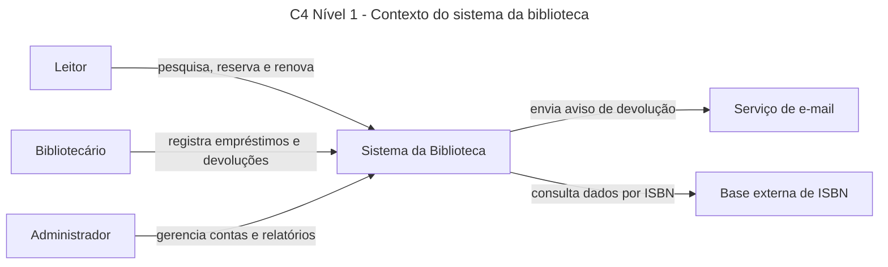
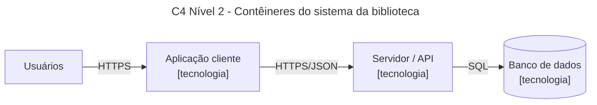
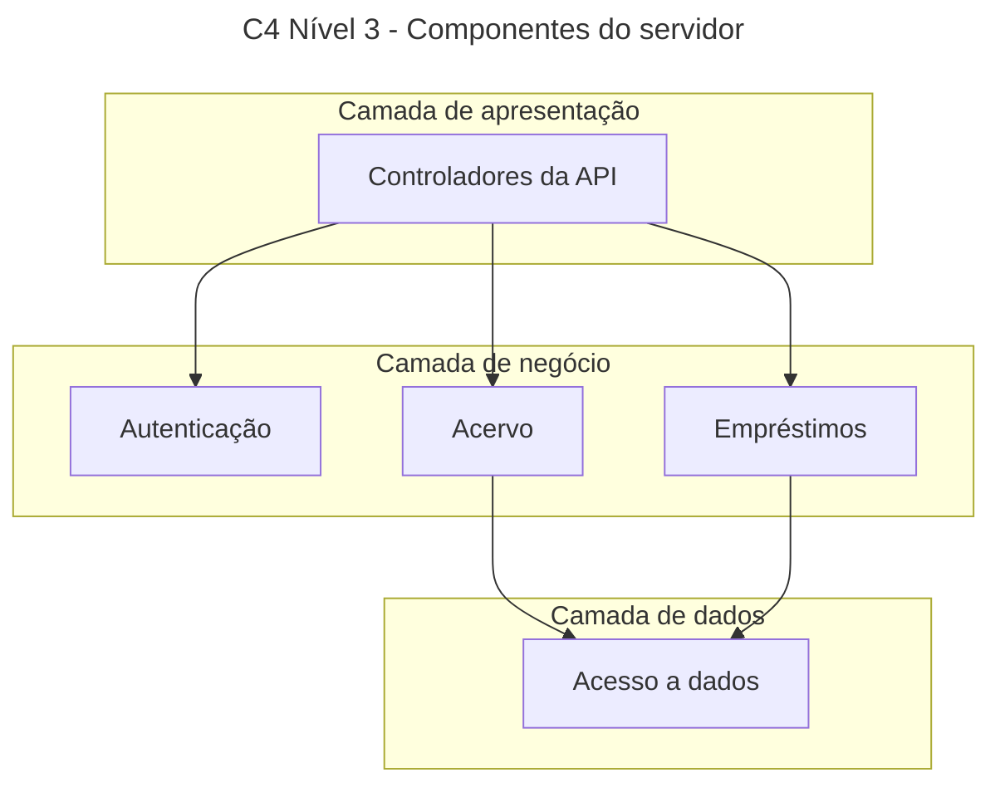
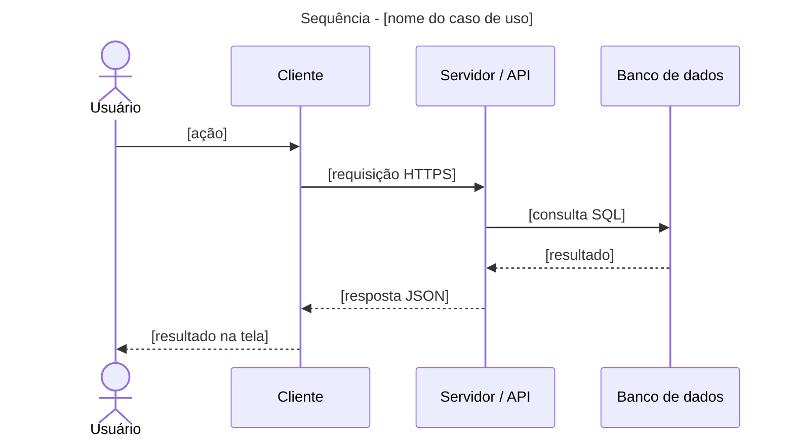

# Biblioteca Comunitária: Requisitos e Arquitetura de um Sistema

**Disciplina:** Projetos de Sistemas · CIESA (Centro Universitário de Ensino Superior do Amazonas)
**Trabalho:** individual
**Autora:** Luchie Bonates Simões
**Tema:** sistema de empréstimos para uma biblioteca comunitária de Manaus

<!-- Os comentários como este não aparecem no GitHub. Servem de lembrete e podem ser apagados no final. -->

---

## Sumário

- [Parte 1: Requisitos](#parte-1-requisitos)
  - [1.1 Descrição do sistema](#11-descrição-do-sistema)
  - [1.2 Tabela de requisitos](#12-tabela-de-requisitos)
- [Parte 2: Documento de arquitetura](#parte-2-documento-de-arquitetura)
  - [2.1 Diagramas C4](#21-diagramas-c4-níveis-1-a-3)
  - [2.2 Registros de decisão (ADRs)](#22-registros-de-decisão-adrs)
  - [2.3 Comunicação cliente-servidor](#23-comunicação-cliente-servidor)
  - [2.4 Rastreabilidade](#24-rastreabilidade)

---

## Parte 1: Requisitos

### 1.1 Descrição do sistema

<!-- Um parágrafo sobre o negócio e os tipos de usuário: leitor, bibliotecário e administrador. -->

[Escrever aqui.]

### 1.2 Tabela de requisitos

<!-- Mínimos: 10 RF, 6 RNF (mensuráveis, em pelo menos 4 categorias) e 5 RN. -->
<!-- RF: "O sistema deve permitir que [usuário] [ação]". RNF: sempre com medida. RN: vale mesmo sem o sistema. -->

#### Requisitos funcionais (RF)

| Código | Tipo | Descrição | Prioridade |
|---|---|---|---|
| RF01 | Funcional | O sistema deve permitir que o ... | Alta |
| RF02 | Funcional | | |
| RF03 | Funcional | | |
| RF04 | Funcional | | |
| RF05 | Funcional | | |
| RF06 | Funcional | | |
| RF07 | Funcional | | |
| RF08 | Funcional | | |
| RF09 | Funcional | | |
| RF10 | Funcional | | |

#### Requisitos não funcionais (RNF)

| Código | Tipo | Descrição | Prioridade |
|---|---|---|---|
| RNF01 | Desempenho | | |
| RNF02 | Segurança | | |
| RNF03 | Disponibilidade | | |
| RNF04 | Usabilidade | | |
| RNF05 | Compatibilidade | | |
| RNF06 | | | |

#### Regras de negócio (RN)

| Código | Tipo | Descrição | Prioridade |
|---|---|---|---|
| RN01 | Regra de negócio | | |
| RN02 | Regra de negócio | | |
| RN03 | Regra de negócio | | |
| RN04 | Regra de negócio | | |
| RN05 | Regra de negócio | | |

---

## Parte 2: Documento de arquitetura

### 2.1 Diagramas C4 (níveis 1 a 3)

<!-- Todo diagrama tem título e legenda. Os níveis não se misturam: o nível 1 não mostra banco de dados. -->

#### Nível 1: Contexto



**Legenda:** caixas são pessoas ou sistemas; cada seta indica o que trafega entre eles.

#### Nível 2: Contêineres



**Legenda:** cada contêiner mostra a tecnologia escolhida; cada seta mostra o protocolo.

#### Nível 3: Componentes do servidor



**Legenda:** os módulos estão agrupados nas três camadas do servidor.

---

### 2.2 Registros de decisão (ADRs)

<!-- 3 ADRs. Cada um com 2 alternativas reais, consequência negativa e um requisito apontado. -->

#### ADR-001: [Título em forma de decisão]

**Status:** proposta
**Data:** AAAA-MM-DD

**Contexto**
Que requisito (RF, RNF ou RN) exige esta decisão agora?

**Alternativas consideradas**
- **Alternativa A: [nome].** A favor: ... Contra: ...
- **Alternativa B: [nome].** A favor: ... Contra: ...

**Decisão**
Escolhi a alternativa [A], porque [razão ligada ao requisito].

**Consequências**
- Positivas: ...
- Negativas: ...

#### ADR-002: [Título em forma de decisão]

**Status:** proposta
**Data:** AAAA-MM-DD

**Contexto**

**Alternativas consideradas**
- **Alternativa A: [nome].** A favor: ... Contra: ...
- **Alternativa B: [nome].** A favor: ... Contra: ...

**Decisão**

**Consequências**
- Positivas: ...
- Negativas: ...

#### ADR-003: [Título em forma de decisão]

**Status:** proposta
**Data:** AAAA-MM-DD

**Contexto**

**Alternativas consideradas**
- **Alternativa A: [nome].** A favor: ... Contra: ...
- **Alternativa B: [nome].** A favor: ... Contra: ...

**Decisão**

**Consequências**
- Positivas: ...
- Negativas: ...

---

### 2.3 Comunicação cliente-servidor

#### Fluxo de requisição e resposta

<!-- Diagrama de sequência de um caso de uso completo: cliente → servidor → banco → resposta. -->



**Legenda:** setas contínuas são pedidos; setas tracejadas são respostas.

#### Requisições HTTP

<!-- 4 requisições, com método, URL, status e JSON. Pelo menos uma com erro 4xx. Cada uma liga a um RF. -->

**Requisição 1: [nome]** (RF__)

- **Método e URL:** `GET /api/...`
- **Status da resposta:** `200 OK`

```json
{}
```

**Requisição 2: [nome]** (RF__)

- **Método e URL:** `POST /api/...`
- **Status da resposta:** `201 Created`

```json
{}
```

**Requisição 3: [nome]** (RF__)

- **Método e URL:** `PUT /api/...`
- **Status da resposta:** `200 OK`

```json
{}
```

**Requisição 4: [nome, caso de erro]** (RF__)

- **Método e URL:** `POST /api/...`
- **Status da resposta:** `4xx`

```json
{}
```

#### HTTPS

<!-- Que dados do sistema precisam de proteção e o que o TLS garante. -->

[Escrever aqui.]

---

### 2.4 Rastreabilidade

<!-- Nenhum RNF pode ficar sem decisão, e nenhuma requisição pode ficar sem RF. -->

#### RNF → decisão

| RNF | Decisão (ADR ou elemento do C4) |
|---|---|
| RNF01 | |
| RNF02 | |
| RNF03 | |
| RNF04 | |
| RNF05 | |
| RNF06 | |

#### Requisição HTTP → RF

| Requisição | RF |
|---|---|
| Requisição 1 | |
| Requisição 2 | |
| Requisição 3 | |
| Requisição 4 | |
